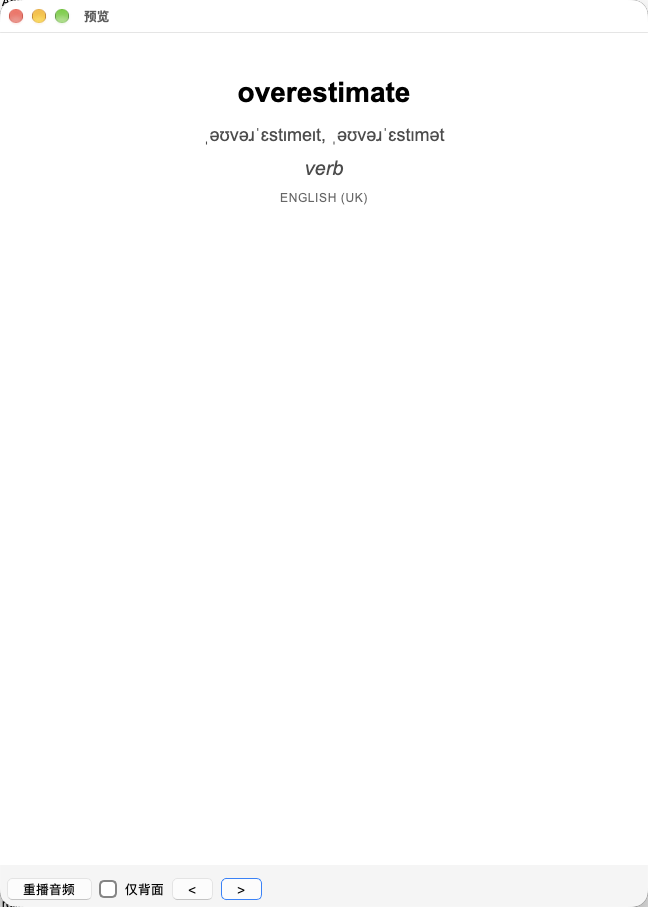
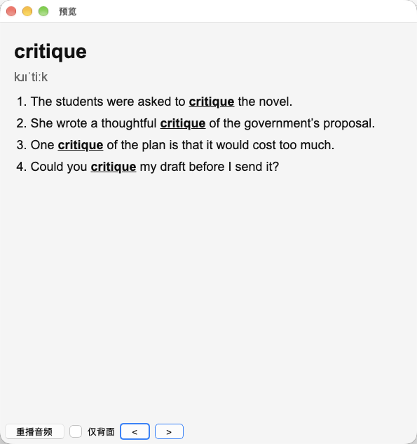
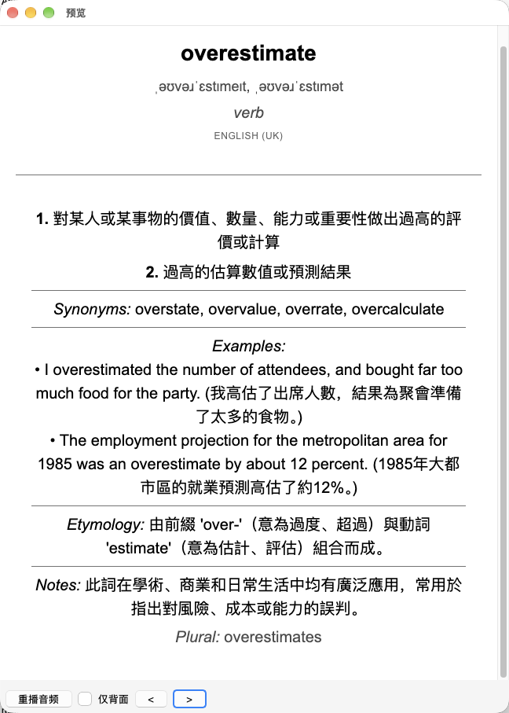
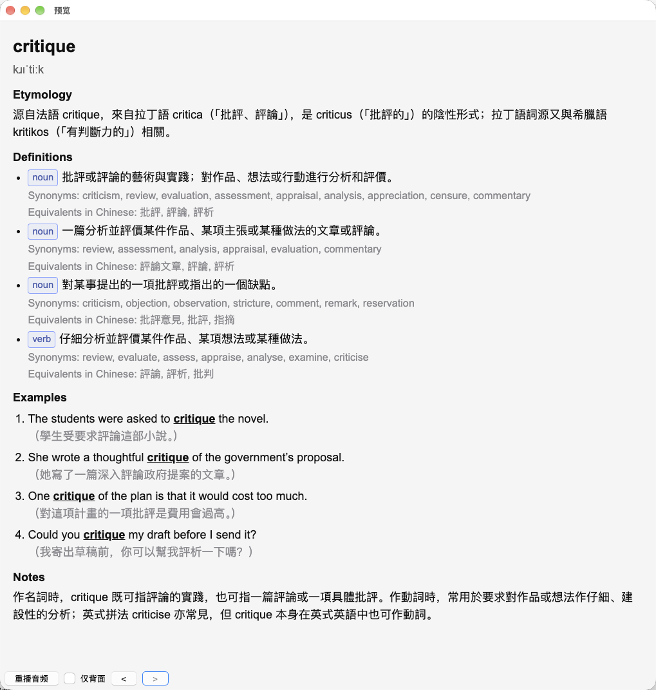
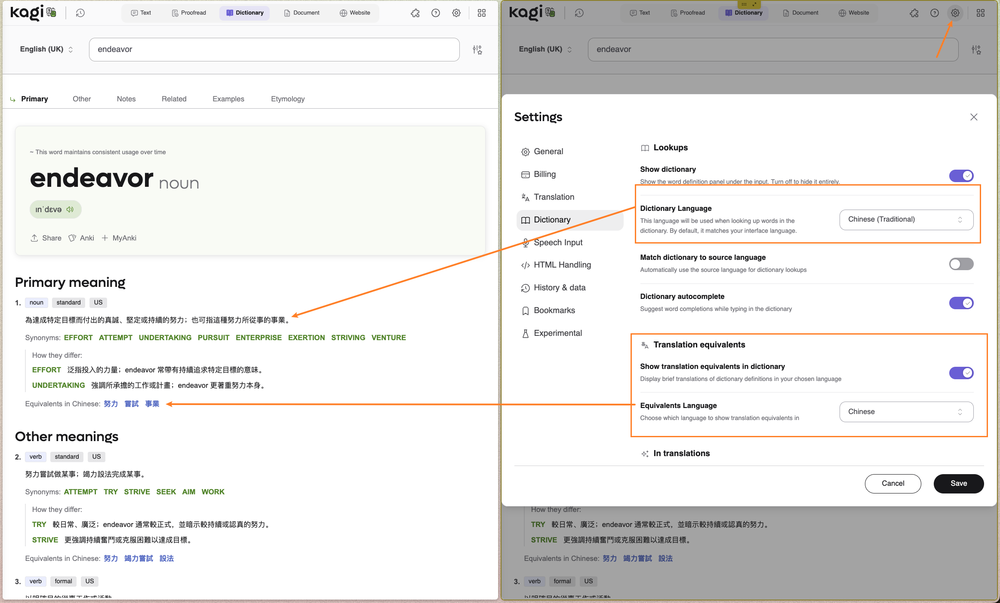

# kagi-anki.user.js

A Tampermonkey userscript that turns a [Kagi Translate](https://translate.kagi.com) dictionary
entry into an Anki note, via the [AnkiConnect](https://git.sr.ht/~foosoft/anki-connect) HTTP API.

The script adds a **MyAnki** button right next to the site's own *Anki* button. Clicking it reads
the word, pronunciation, definitions, synonyms, examples, notes and etymology from the current
dictionary page and creates a new note.

Built by OpenCode + DeepSeek Flash V4.1.

## Compared with Kagi Translate's Built-in Anki Feature

Kagi Translate has its own **Anki** button. This userscript builds a card tuned for recall rather
than a plain export:

- **Examples on the front** — context that makes the meaning easier to recall before you flip.
- **Etymology at the top of the back** — word origins are a strong memory hook.
- **Part of speech before each definition** — `noun` / `adjective`, shown as a bordered chip.
- **Synonyms and equivalents under each definition** — shown dimmed beneath the meaning, including
  any *Equivalents in …* row (e.g. Chinese) from the page.
- **Target word highlighted** — bold and underlined in every example sentence.
- **Translation on its own line, dimmed** — the source-language example stays prominent and the
  parenthesised translation doesn't distract.

|       | Built-in Anki                        | This Script                                 |
|-------|--------------------------------------|---------------------------------------------|
| Front |  |  |
| Back  |   |   |

## Requirements

- Anki (desktop) with **AnkiConnect** enabled.
- A userscript manager — [Tampermonkey](https://www.tampermonkey.net/).

## Installation

### 1. AnkiConnect

- In Anki, go to `Tools → Add-ons → Get Add-ons` and enter code `2055492159`, then restart Anki.
- Go to `Tools → Add-ons → AnkiConnect → Config` and add this site to webCorsOriginList:

```json
"webCorsOriginList": [
  "http://localhost",
  "https://translate.kagi.com"
]
```
- Close and reopen Anki for the changes to take effect.

### 2. Userscript

1. Install Tampermonkey.
2. Open [`kagi-anki.user.js`](kagi-anki.user.js) — Tampermonkey should offer to install it — or create
   a new script in the Tampermonkey dashboard and paste its contents in.

## Configuration

Settings are stored by the userscript manager (Tampermonkey) as script values:

| Key        | Default                  | Meaning                                             |
| ---------- | ------------------------ | --------------------------------------------------- |
| `endpoint` | `http://127.0.0.1:8765`  | AnkiConnect URL                                     |
| `apikey`   | *(empty)*                | AnkiConnect `apiKey`, if you have one configured   |
| `deck`     | *(empty)*                | Remembered deck name                                |
| `model`    | `Kagi Dictionary`        | Remembered note type                                |
| `tags`     | `kagi-translate`         | Comma-separated tags to add to new notes            |

Change `deck` / `model` from the picker; other values can be edited in the Tampermonkey dashboard
(*Settings* / script storage).

### Recommended Kagi Translate Dictionary Config

Set *Dictionary Language* and *Equivalents Language* to the language you use.



## License

[Unlicense](LICENSE).
