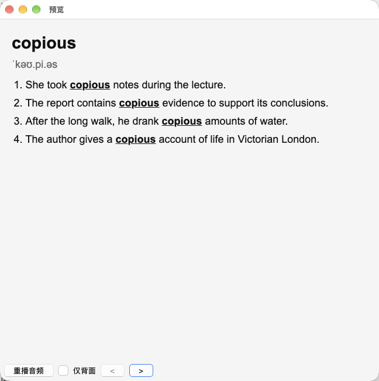
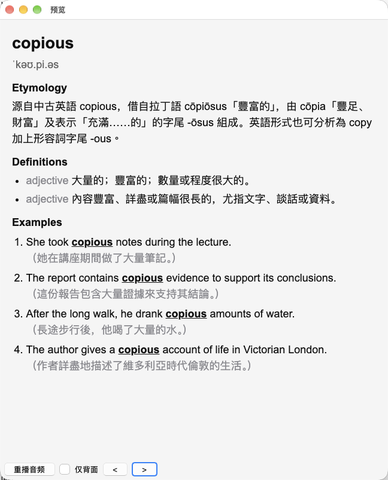

# Kagi Translate → Anki

A Tampermonkey userscript that turns a [Kagi Translate](https://translate.kagi.com) dictionary
entry into an Anki note, via the [AnkiConnect](https://foosoft.net/projects/anki-connect/) HTTP API
on `127.0.0.1:8765`.

The script adds a **加入 Anki** button right next to the site's own *Anki* button. Clicking it reads
the word, pronunciation, definitions, examples, notes and etymology from the current dictionary page
and creates a new note.

Built by OpenCode + DeepSeek Flash V4.1.

## Compared with Kagi Translate's Built-in Anki Feature

Kagi Translate has its own **Anki** button. This userscript builds a card tuned for recall rather
than a plain export:

- **Examples on the front** — context that makes the meaning easier to recall before you flip.
- **Etymology at the top of the back** — word origins are a strong memory hook.
- **Part of speech before each definition** — `noun` / `adjective`, shown dimmed.
- **Target word highlighted** — bold and underlined in every example sentence.
- **Chinese translation on its own line, dimmed** — the English example stays prominent and the
  Chinese doesn't distract.

|       | Built-in Anki           | This Script      |
|-------|-------------------------|------------------|
| Front |  |  |
| Back  |   |   |

## Requirements

- Anki (desktop) with **AnkiConnect** enabled and listening on `127.0.0.1:8765`.
- AnkiConnect's CORS allow-list must include `https://translate.kagi.com`. The fork vendored in
  [`ankiconnect/`](ankiconnect/) already does this.
- A userscript manager — [Tampermonkey](https://www.tampermonkey.net/) (or Violentmonkey).
- A browser that allows an `https://translate.kagi.com` page to POST to `http://127.0.0.1:8765`
  (loopback is treated as a secure context; the vendored fork also answers the Private Network Access
  preflight).

## Installation

### 1. AnkiConnect

Pick one:

- **Use the vendored fork (recommended for this project).** Copy the [`ankiconnect/`](ankiconnect/)
  folder into Anki's add-ons directory (in Anki: *Tools → Add-ons → View Files*, then go up one
  level). Restart Anki.
- **Use upstream AnkiConnect.** Install it from AnkiWeb (**Code: 2055492159**), then open *Tools → Add-ons → AnkiConnect →
  Config* and add `https://translate.kagi.com` to `webCorsOriginList`:

  ```json
  "webCorsOriginList": ["http://localhost", "https://translate.kagi.com"]
  ```

### 2. Userscript

1. Install Tampermonkey.
2. Open [`kagi-anki.user.js`](kagi-anki.user.js) — Tampermonkey should offer to install it — or create
   a new script in the Tampermonkey dashboard and paste its contents in.


## Configuration

Settings are stored by the userscript manager (Tampermonkey) as script values:

| Key        | Default                  | Meaning                                             |
| ---------- | ------------------------ | --------------------------------------------------- |
| `endpoint` | `http://127.0.0.1:8765`  | AnkiConnect URL                                     |
| `apikey`   | *(empty)*                | AnkiConnect `apiKey`, if you have one configured   |
| `deck`     | *(empty)*                | Remembered deck name                                |
| `model`    | `Kagi Dictionary`        | Remembered note type                                |
| `tags`     | `kagi-translate`         | Comma-separated tags to add to new notes            |

Change `deck` / `model` from the picker; other values can be edited in the Tampermonkey dashboard
(*Settings* / script storage).

### The `Kagi Dictionary` note type

Auto-created with two fields (`Front`, `Back`) and one card template:

- Front template: `{{Front}}`
- Back template: `{{Back}}`

Because the back template does not use `{{FrontSide}}`, the front's examples are only shown while the
question is displayed and are not repeated on the answer.

## Licensing & attribution

- **`kagi-anki.user.js` and this README** are released into the public domain under the
  [Unlicense](LICENSE). The script contains no AnkiConnect code; it only talks to AnkiConnect's
  public HTTP/JSON API at runtime.
- **`ankiconnect/`** is a lightly modified copy of **AnkiConnect** by Alex Yatskov / FooSoft, licensed
  under the **GNU General Public License, version 3 or later** (GPL-3.0-or-later). It is vendored
  here for reference; the local modification adds `https://translate.kagi.com` to the CORS
  allow-list. See [`ankiconnect/LICENSE`](ankiconnect/LICENSE) and the original copyright headers in
  each file. Upstream: <https://foosoft.net/projects/anki-connect/>.

## Disclaimer

This project is not affiliated with, endorsed by, or sponsored by Kagi or the AnkiConnect authors.
Kagi Translate, Anki and AnkiConnect are the property of their respective owners.
